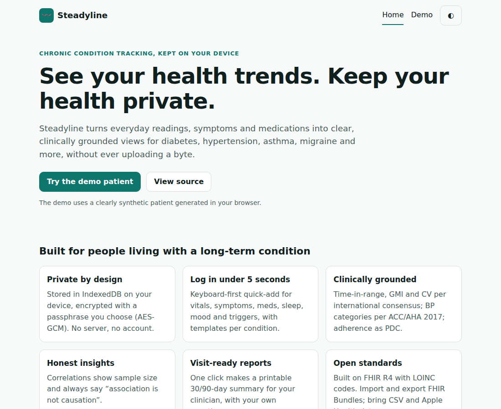
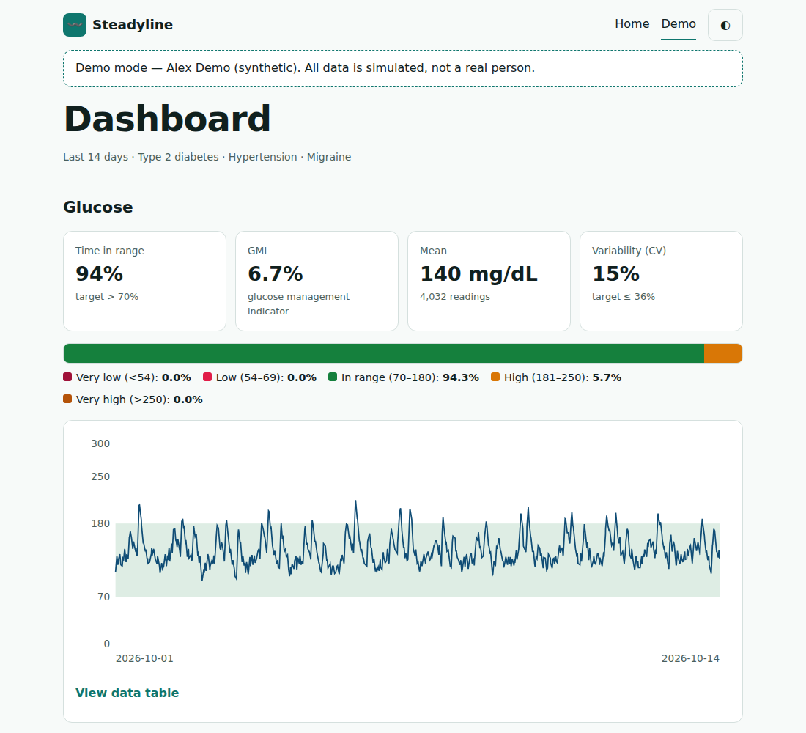
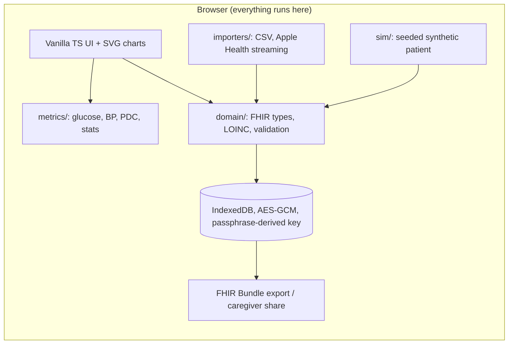

# Steadyline

**Live demo: https://striv11.github.io/steadyline/** (demo status: _live once Pages is enabled on the first push_)

> A private, local-first dashboard for people managing chronic conditions. Clinically grounded metrics, FHIR-based data, and nothing ever leaves your device.





> **Not medical advice. Not a diagnostic device.** Steadyline never recommends doses or diagnoses. It helps you see your own data and prepare for conversations with your care team.

## Two parts, one product

|                     | What                                                                                                                                                                                                     | Where                                                                  |
| ------------------- | -------------------------------------------------------------------------------------------------------------------------------------------------------------------------------------------------------- | ---------------------------------------------------------------------- |
| **Steadyline**      | A private, local-first dashboard where patients track their own condition (this page).                                                                                                                   | `src/`, live on GitHub Pages                                           |
| **Steadyline Care** | The care operations platform: patients book home nursing, clinic visits and medicine delivery; caregivers and couriers run their day on their phones; dispatchers staff jobs and handle clinical alerts. | [`platform/`](platform/README.md), deploy with Docker or `render.yaml` |

## Problem

People living with diabetes, hypertension, asthma/COPD, IBD, migraine, rheumatoid arthritis/lupus, kidney disease or heart failure generate a lot of data (meter readings, symptoms, meds, sleep) scattered across apps, paper logs and device exports. Most tracking apps want an account and upload health data to a server. Clinic visits are short, and patients struggle to show trends, adherence and the questions they meant to ask.

## Motivation

Build a funded-startup-quality health product with a strict privacy stance: **no server, no accounts, encrypted at rest**. Engineering ideas explored:

- A condition-aware data model on **FHIR R4** (Patient, Condition, Observation + LOINC, MedicationStatement/Administration) so exports are interoperable.
- Metrics implemented from the published consensus papers and verified against their worked examples.
- Streaming parsers for large exports (CGM CSV, Apple Health `export.xml`).
- Honest statistics: permutation tests, multiple-comparison correction, sample sizes shown, "association is not causation".
- A performance budget: one year of minute-level CGM data (~525k points) renders in under a second through min/max downsampling.

## Architecture



Key invariants:

- Domain code is pure (no DOM, no storage) and fully unit-tested.
- Every resource crossing a boundary (import, storage load) passes `validateResource`.
- The simulator is deterministic: same seed, same output. Demo data is tagged `synthetic`.
- No network calls to third parties. Hash routing so it works on static hosting.

Layout: `src/domain` (FHIR model, codes, validation), `src/metrics` (glucose, downsampling), `src/sim` (seeded generator), `src/ui` (views, charts, CSS), `e2e/` (Playwright).

## Setup

Requires Node 22+.

```bash
npm ci
npm run dev        # http://localhost:5173
bash check.sh      # format check, lint, typecheck, unit tests, build
npx playwright install chromium && npm run e2e
```

## Demo

Open the live link (or `npm run dev`), click **Try the demo patient**. You get a synthetic patient ("Alex Demo") with 14 days of CGM data: time in range, GMI, CV, a stacked range bar and a glucose chart with an accessible data table. Press `t` to toggle theme. Status: **landing + glucose demo shell live; remaining panels planned** (see PLAN.md).

## Clinical references

| Metric                            | Source                                                  |
| --------------------------------- | ------------------------------------------------------- |
| TIR/TAR/TBR ranges, CV ≤36 %      | Battelino T et al., _Diabetes Care_ 2019;42:1593–1603   |
| GMI = 3.31 + 0.02392 × mean mg/dL | Bergenstal RM et al., _Diabetes Care_ 2018;41:2275–2280 |
| BP categories                     | Whelton PK et al., 2017 ACC/AHA Hypertension Guideline  |
| Adherence as PDC (planned)        | Pharmacy Quality Alliance PDC specification             |

LOINC/SNOMED codes are listed in `src/domain/codes.ts`; verify against the current LOINC release before any clinical use (the peak-flow code in particular is flagged for review).

## Design decisions & trade-offs

- **Vanilla TypeScript, no framework:** tiny bundle, fast first paint, fewer dependencies to audit. Costs some boilerplate; a small `h()` helper keeps rendering injection-safe (text nodes only).
- **CGM stored separately from FHIR Observations:** 500k Observation JSON objects would be too heavy; CGM is a typed time series, exported to FHIR on demand.
- **Hash routing:** works on GitHub Pages without server rewrites.
- **Min/max downsampling** rather than averaging so hypoglycaemic dips stay visible.

## Roadmap

See [PLAN.md](PLAN.md) for the 14-day arc.

- [x] Day 1: scaffold, FHIR model + validation, synthetic patient, glucose metrics, landing + demo shell
- [ ] Encrypted IndexedDB, onboarding, fast logging
- [ ] Importers (CSV, Apple Health, Health Connect)
- [ ] Dashboard panels (AGP, BP, PDC, symptom heatmap, flares)
- [ ] Insights engine
- [ ] Reminders/PWA, doctor report, caregiver mode
- [ ] Polish, a11y audit, performance benchmark

## License

MIT. See [LICENSE](LICENSE).
